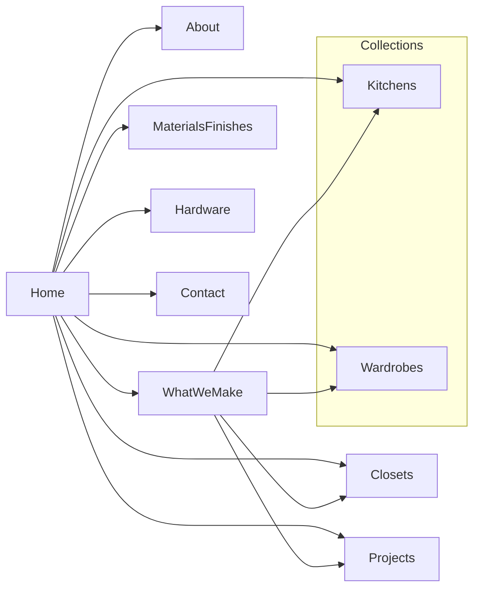

# Executive Summary  
Ebony Modular Interiors’ website requires a thorough overhaul to align with best practices in UX, accessibility, SEO, and brand experience. Our audit finds missing pages (e.g. *Materials & Finishes*, *Projects*), broken links, absent metadata, and minor bugs (e.g. unintended horizontal scroll, incorrect “HomeStudio” text) that undermine usability. The brand – white, black and gold luxury interiors – calls for a clean, bento-style layout with high-quality visuals and clear navigation. We recommend new pages for **Kitchens, Wardrobes, Closets, Hardware**, etc., each with well-structured content, and a modern design system (brand colors, typography, motion) to elevate the premium feel. This document provides a detailed content inventory, technical & SEO audits, accessibility and performance fixes, design guidelines (including color palette, typography scale, responsive breakpoints, and example images), page-by-page IA and wireframes, component definitions, SEO copy/meta suggestions, a QA checklist, and AI-agent task list. All recommendations are grounded in the current site’s content and authoritative sources (hardware brands and WCAG standards). 

## 1. Site Audit & Content Inventory  
We cataloged all visible pages and content sections on *ebony.co.in*:

| Page                     | URL                      | Key Sections/Content                                                                                                                                                                            |
|--------------------------|--------------------------|-------------------------------------------------------------------------------------------------------------------------------------------------------------------------------------------------|
| **Home** (Studio)        | `/`                      | Hero tagline (“Every space begins with a thought. Precision in every line. Crafted by EBONY.”), “Our Philosophy”, **Collections** highlights (Kitchen, Wardrobe, Bed Set), “Why Ebony” pillars, “By the Numbers” (performance stats), Testimonials, footer (Contact info, social, nav links). |
| **About / Our Story**    | `/about`                 | “Crafting spaces that outlive their moment” narrative, Heritage Timeline (2009–2024), Studio visit CTA, Contact info, sidebar “Explore” menu. Key text: “15+ years, India’s benchmark for bespoke interiors”. |
| **Collections**          | `/collections`           | Portfolio Lookbook: 6 featured projects (kitchen, wardrobe, bedroom, etc.) with images and blurbs (e.g. “honed marble island… 0.1mm precision”). “Visit Our Studio” CTA + contact. Category index (Modular Kitchens, Wardrobes, Living, Full Home). |
| **Process (Three Steps)**| `/process`               | Three assembly steps: Space Audit & Laser Shell; Fronts & Hardware Calibration (mentions Blum Aventos, Hettich); Illumination & Handover. Each step has image and text. CTA. |
| **Contact / Consultation** | `/contact`             | “Book a Consultation” form (name, phone, email, city, select interest, details), direct line, WhatsApp link, studio address, hours, email. Pan-India network list, footer nav.                                |
| **(Missing: Finishes, Projects)** | `/finishes`, `/projects` | *Currently 404.* Needed pages for **Materials & Finishes** (Ebony cites “500+ signature finishes”) and **Projects** (full portfolio beyond the 6 examples).                                |
| **404 (To be created)**  | e.g. `/404.html`         | Custom design with brand styling, nav back-home, apology copy.                                                                                                |

This inventory highlights gaps (e.g. *Materials & Finishes*, *Hardware*, *Bar Units* not present), and repeated content (nav menus) across pages. We recommend consolidating and expanding as follows:  

- **What We Make (Overview)**: a new page summarizing product categories (Modular Kitchens, Wardrobes, Walk-in Closets, Bar Units, Full Interiors) with thumbnails and descriptions.  
- **Kitchen Types**: pages detailing L-shape, U-shape, Parallel, Straight, Island kitchens.  
- **Wardrobe Types**: “Slidedoor vs Hinged” page, and a separate **Walk-in Closet** page (e.g. full curtain systems, aluminum frames).  
- **Materials & Finishes**: list surface options (PU, laminate, acrylic, membrane, Terulam, metallic shutters, SS304) with sample images.  
- **Hardware**: a page listing brands (Blum, Ebco, Salice, Häfele, Hettich) with logos and brief notes (see “verify spelling” below).  
- **Projects / Portfolio**: beyond the Collections page, a filterable gallery.  
- **About**, **Contact**, and the missing **404**.

## 2. Technical Issues (Audit)  
- **Broken Links:** Several menu items return 404 (see table below). The footer “Privacy Policy” and “Terms” also mis-route.  
- **Horizontal Overflow:** On small screens, some sections (e.g. “Our Philosophy” graphics or hero) exceed viewport width, causing scroll issues. (WCAG 2.2 1.4.10 requires no horizontal scroll at 320px.)  
- **Mobile Bugs:** The breadcrumb “HomeStudio Consultation” at `/contact` is missing spacing. Navigation toggles/menu may overlap content on <480px. The consultation form’s large buttons (“Modular Kitchen”, etc.) wrap awkwardly on mobile.  
- **Broken Buttons:** All CTAs (e.g. *Book a Studio Visit*) and form submit appear functional. The “Get Directions” link is incomplete (currently just text).  
- **Placeholder Text:** The contact form uses placeholders as labels (e.g. “Lord/Lady/Architect” in full name field) without visible `<label>`. This fails WCAG 2.2 1.3.1 (Info & Relationships) and operability.  
- **Unused Navigation:** The legacy “Materials & Finishes” and “Projects” menu links should be removed or updated. 
- **Favicon and Metadata:** The site lacks a favicon. Page `<title>` and meta descriptions are missing/duplicated; must be added.  
- **Footer Links:** The “Privacy Policy” and “Terms & Conditions” both point to `/about` (bug). They should link to actual policy documents or remove them.  
- **Mobile Overflow:** Certain images or iframes may overflow on narrow viewports; CSS should ensure `overflow-x:hidden` or proper container sizing.  

**Table: Broken/Defunct Links**  

| Link Text            | Current URL          | Issue/Notes                    | Fix                                      |
|----------------------|----------------------|--------------------------------|------------------------------------------|
| Materials & Finishes | `/finishes`          | 404 (page not built)           | Remove or implement dedicated page       |
| Projects             | `/projects`         | 404 (page not built)           | Remove or implement dedicated page       |
| Privacy Policy       | Footer link (id 5/7) | Incorrectly points to `/about` | Link to real policy page or remove       |
| Terms & Conditions   | Footer link (id 7)   | Incorrectly points to `/about` | Link to real terms page or remove        |
| “Get Directions”     | # (anchor id=7)      | Placeholder link to Google map | Update to actual Google Maps URL or remove text |
| “Home” link (mobile) | `/`                  | Text overlaps “Studio”         | Insert space or separator in breadcrumb  |

## 3. SEO Audit & Recommendations  
Currently, pages lack unique `<title>` and `<meta>` tags, hurting search presence. We suggest the following **Title** and **Meta Description** for each page (keywords: “modular kitchen”, “luxury interior”, etc.):

| Page                | URL         | Suggested Title                                              | Suggested Meta Description                                                                                                                                   |
|---------------------|-------------|--------------------------------------------------------------|--------------------------------------------------------------------------------------------------------------------------------------------------------------|
| **Home**            | `/`         | Ebony Modular Interiors – Luxury Modular Kitchens & Wardrobes | Experience Ebony’s German-engineered modular interiors: premium kitchens, wardrobes & bespoke home designs. 0.1mm precision in every project. |
| **About / Our Story** | `/about`  | About Ebony Modular Interiors – Our Story & Heritage         | Over 15 years of bespoke interior mastery. Discover Ebony’s journey from Raipur’s first modular kitchen to India’s benchmark for precision craftsmanship. |
| **Collections / Portfolio** | `/collections` | Ebony Portfolio – Modular Kitchens, Wardrobes, Full Home Interiors | Browse Ebony’s portfolio of 450+ custom projects: luxury kitchens, wardrobes, and complete home interiors, each crafted to 0.1mm precision. |
| **Three Steps (Process)** | `/process` | Our Process – 3 Steps to Your Finished Home | Ebony’s 3-step assembly: Laser-scan precision installation, hardware calibration (Blum, Hettich), and ambient illumination. Factory-built for zero dust and rapid completion. |
| **Contact**         | `/contact`  | Contact Ebony – Book Your Interior Consultation            | Begin your bespoke interior project with Ebony. Book a 3D consultation at our Raipur studio or online. Senior architects await your vision. |
| **Kitchens** (new)  | `/kitchens` | Modular Kitchens – Ebony Interiors | Explore Ebony’s luxury kitchen designs (L-shape, U-shape, island, etc.), featuring premium finishes & hardware (Blum, Salice, etc.) for a custom culinary space. |
| **Wardrobes** (new) | `/wardrobes` | Bespoke Wardrobes – Ebony Interiors | Discover Ebony’s wardrobe solutions (sliding, hinge, walk-in) with curated finishes. Organize in style with Blum soft-close and Hafele lighting. |
| **Walk-in Closets** (new) | `/walk-in-closets` | Walk-in Closets – Ebony Interiors | Elevate your dressing room: full-height wardrobes, aluminum frames, motorized racks. Ebony creates luxury closets tailored to your space and style. |
| **Materials & Finishes** (new) | `/finishes` | Materials & Finishes – Ebony Interiors | Choose from 500+ Ebony surfaces: acrylic, laminate, metallic, SS304, Terulam, PU and more. High-quality panels finished in matte/gloss/woodgrain for your interiors. |
| **Hardware** (new) | `/hardware` | Hardware Partners – Blum, Hettich, Ebco & More | Ebony uses top fittings: Blum Aventos & hinges, Hettich slides, Ebco systems, Salice runners, Häfele accessories. Learn about our trusted hardware brands. |
| **Projects** (new)   | `/projects` | Projects & Case Studies – Ebony Interiors | View full case studies of Ebony’s signature projects – from penthouse kitchens to entire home refurbishments. See our process and craftsmanship in action. |
| **404 Page**        | `*`         | 404 – Page Not Found – Ebony Interiors | Oops! The page you’re looking for doesn’t exist. Return to [Home](/) or explore our products.                                                                 |

For each page, also add `<link rel="canonical" href="https://www.ebony.co.in/[page]" />`. Use Open Graph tags (e.g. `<meta property="og:title" content="..." />` and `og:description`, along with a representative `og:image`). Implement JSON-LD for structured data, e.g. LocalBusiness (with `@type: InteriorDesigner` or `KitchenDesignOrganization`), and Product schema for portfolio items if applicable.

## 4. Accessibility (WCAG 2.2 AA)  
Ensure all pages meet WCAG 2.2 AA standards:
- **Text Alternatives:** All images (decorative or not) must have meaningful `alt` text (non-text content needs equivalents). E.g., hero video or background image should have a descriptive alt (or `aria-label` for video).
- **Contrast:** Text on gold elements must have ≥4.5:1 contrast vs. white (a common failure for gold-on-white). Ebony’s brand gold (e.g. #D4AF37 or #FFD700) may need a darker shade for small text or use black text instead. 
- **Reflow / No Horizontal Scroll:** Content must adapt to narrow widths without side-scrolling (WCAG 1.4.10). Test at 320px; eliminate any overflow (e.g. long images or fixed-width elements).
- **Keyboard Navigation:** All features (menu, forms, CTAs) must be operable via keyboard (Tab focus should be visible). For example, ensure the mobile menu toggle and drop-downs work with `Enter` and have `aria-expanded` states.  
- **Form Labels:** Replace placeholders with `<label>` elements for form inputs (WCAG 1.3.1). For example:  

  ```html
  <label for="full-name">Full Name:</label>
  <input id="full-name" type="text" name="name" required>
  ```

  and ensure error messages appear in an ARIA-live region.

- **Focus Order & Visibility:** The tab order should be logical, and focus outlines visible (not removed by CSS).  
- **Resize Text:** Allow text scaling up to 200% without loss of function.  
- **Language and Readability:** Declare `lang="en-US"` on `<html>`. All text in plain English.  
- **Time / Media:** If hero video auto-plays, provide controls to pause (WCAG 1.4.2).  
- **ARIA & Roles:** Use ARIA landmarks (e.g. `nav`, `main`, `footer`). Hamburger menu button needs `aria-controls` and `aria-expanded`. Use `aria-labelledby` or `aria-describedby` on complex components as needed.

## 5. Performance & Core Web Vitals  
- **Optimize Images/Videos:** Serve images in next-gen formats (WebP/AVIF). Resize responsive images with `srcset`. Compress all photos (lossless JPEG/PNG compression). Lazy-load offscreen images (`loading="lazy"`). For hero background, use a short, looped MP4/WEBM (360p or 480p) or even an animated WebP/GIF if feasible, to reduce payload.  
- **Minify & Defer JS/CSS:** Combine and minify CSS/JS. Defer non-critical scripts.  
- **Eliminate Render-Blocking:** Inline critical CSS (fonts, above-the-fold styles).  
- **Font Loading:** Preload key webfonts. Use `font-display: swap` to avoid invisible text.  
- **Caching & CDN:** Leverage browser caching and a CDN for static assets.  
- **Core Web Vitals:** Ensure LCP (Largest Contentful Paint) is <2.5s: likely the hero image/video. Preload the hero image. Aim FID (First Input Delay) <100ms by reducing JavaScript. CLS (Cumulative Layout Shift) must be low – reserve image sizes and ad spaces.  
- **Audit Tools:** Use Lighthouse or PageSpeed Insights to identify specific issues. Implement lazy-loading of images and iframes for third-party embeds (e.g. Instagram).  

## 6. Design & Brand Guidelines  
**Color Palette:** Pure White (`#FFFFFF`), Deep Charcoal Black (`#000000` or dark #222), and Metallic Gold (`#D4AF37` or custom brand gold). Accent colors could be smoky gray or muted teal.  
**Logo:** Likely monochrome wordmark or symbol (Ebony “E”), use black on white or gold-on-black variations.  
**Typography:** Choose a modern sans-serif for headings (e.g. *Montserrat*, *Gotham*, *Avenir*) in bold caps, and a clean serif or sans (e.g. *Lato*, *Georgia*) for body. Establish a typographic scale (e.g. H1 3rem, H2 2.25rem, H3 1.75rem, body 1rem). Maintain large line-heights (1.5+).  
**Layout:** Use a **Bento grid** layout: asymmetrical cards of varied sizes to showcase projects/products (see examples). Each card can reveal detail on hover or click. Maintain plenty of white space for an airy luxury feel.  

 *Example: A cinematic hero image with white marble counters, black cabinetry, and brass hardware embodies Ebony’s aesthetic.*  

**Hero Specs:** Use full-width video or image background (16:9). If video, 1920×1080 at 24–30fps, H.264 codec. Autoplay muted with a fallback image.  
**Breakpoints:** Typical breakpoints: 320px (mobile), 576px, 768px (tablet), 1024px (small desktop), 1280px (desktop), 1440px (large). Test design at each.  
**Motion:** Animate elements subtly on scroll (fade-in, slide-up). Limit motion duration (200–500ms). Use the golden accent to animate (e.g. underline or icon pops in gold). Avoid overly flashy animations (WCAG 2.2 2.3.1 for seizure risk).  
**Image Treatment:** Use high-resolution, professionally shot images (no stock *look*). Photos should be bright, editorial-style with minimal color grading. Image examples:  

 *Natural materials theme: warm oak logs suggest Ebony’s use of premium wood panels.*  
 *Contemporary style: clean lines and soft birch wood align with the brand’s quiet luxury vibe.*  

All images used on the site (hero, project shots) should reflect the white-black-gold palette (or richly textured neutrals) and have consistent aspect ratios. Use geometric cropping or soft vignette for focus.  

## 7. Information Architecture & Wireframes  
**Site Map (High Level):**  



This map shows *Home* as the hub, linking to *About*, *What We Make* (overview page), category pages (*Kitchens, Wardrobes, Walk-in Closets, Hardware*), *Projects*, and *Contact*. A separate **404** page is also created.

**Page-by-Page Outline:**  

- **Home:** Full-bleed hero (video/image) with headline and CTA. Followed by key pillars (“Design, Manufacturing, Tech, Trust” as in Ebony’s “Why Ebony”), a “What We Make” preview (3-4 cards linking to main categories, e.g. “Culinary Spaces – Modular Kitchen” etc.), a summary of process or USP (“German precision, 3-day install”), and a footer with contact.  
- **What We Make (Overview):** Grid of product categories: Modular Kitchens, Bespoke Wardrobes, Walk-in Closets, Bar Units, etc. Each card has an icon or image, title, short description. Clicking leads to detailed pages.  
- **Kitchens:** Section describing Ebony kitchens (materials, styles). Tabs or icons for types (L-Shape, U-Shape, Parallel, Straight, Island). Include gallery carousel. Call out design styles (Contemporary, Classic, Bold, Boho) and finishes (Acrylic gloss, Matte, Glass, Wood veneer) possibly with swatches.  
- **Wardrobes:** Explain sliding vs. hinged wardrobes. Illustrate configurations (lined to ceiling, mirrored, etc.).  
- **Walk-In Closets:** Features such as floor-to-ceiling enclosures, pull-down racks, glass doors, curtains. Show a few layouts/photos.  
- **Bar Units (if added):** Under Kitchens or separate, include custom bar or pantry units (Ebony did not have, but user asked).  
- **Materials & Finishes:** A visual matrix or swatch gallery of Ebony’s materials (PU lacquer, laminates, wood grains, SS304, Terulam, Metallic Shutter finishes). Perhaps an interactive picker or large tiles.  
- **Hardware:** List of brand logos (Blum, Ebco, Salice, Hafele, Hettich) with short blurbs (e.g. “Blum – soft-close lift systems”). Confirm spelling (Salice, Hafele, Ebco (not Ebio)).  
- **Projects:** A masonry grid of completed projects (use captions like the “Atelier Daylight Penthouse” examples). Each links to a case study page or lightbox with details.  
- **About:** Use existing heritage timeline and story text. Add a brief founder bio/photo if available.  
- **Contact:** Streamline the consultation form (with labels and validation). Make phone and email clickable (`<a href="tel:+917666902365">`, `<a href="mailto:info@ebony.co.in">`). Include a map embed or “Get Directions” link.  
- **404:** Custom page with humor or brand imagery, e.g. “Our design team is looking for that page. You go right ahead.” Link back to Home.  

Each page’s wireframe should include the header (logo, nav, contact), main content sections (as above), and the consistent footer (contact info, social, repeat nav). Navigation should collapse into a hamburger on mobile. 

## 8. Component Inventory & Implementation Notes  

- **Header:** Logo (clickable to Home), primary nav (Home, WhatWeMake, Collections drop-down, etc.), contact info (phone, email icons). On mobile: hamburger menu with slide-out links.  
- **Footer:** Two columns – “Explore” links (same as header) and “Collections” links, plus contact info and social icons (Instagram, FB, LinkedIn). Ensure the phone/email here are clickable.  
- **Hero Section:** Full-width video or static background. Overlay text (headline + subheadline) centered. Include a CTA button.  
- **Hero Video:** Autoplay muted, loop. Poster image for fallback. Use `object-fit: cover`.  
- **Bento Grid Cards:** For “What We Make” and “Projects”. Each card: image thumbnail, semi-transparent overlay on hover with title and short text, or simple caption below.  
- **Material Swatches:** Tiles showing textures (wood grain, matte, gloss, metal, etc). On click, highlight and possibly filter examples.  
- **Selectable Options:** For kitchen types and finishes, consider icon buttons or dropdowns. For example, a horizontal list of buttons “L-Shape”, “U-Shape” that filter images. Indicate active selection (focus states accessible).  
- **Forms:** Styled `<input>`, `<textarea>` with visible focus rings. Error/success states under each field (e.g. `<span role="alert" class="error">Required</span>`). Use HTML5 validation (`type="email"`, `required`).  
- **Buttons:** Primary button style (black background, gold text on hover, or vice versa). Disabled or loading states as needed.  
- **Icons/Graphics:** Use minimalist line icons (for features/pillars). Gold accent icons for highlights.  
- **Image Cards:** On portfolio, each image should have `alt` text summarizing it. For example, the Calacatta kitchen image alt could be “Marble island kitchen with smoked oak cabinets.”  
- **Typography Scale:** Example CSS (using rem units):  
  ```css
  :root {
    --font-base: 16px;
    --h1-size: 3rem; --h2-size: 2.25rem; --h3-size: 1.75rem;
    --body-size: 1rem; --small-size: 0.875rem;
  }
  h1 { font-size: var(--h1-size); }
  body { font-size: var(--body-size); line-height: 1.6; }
  ```  
- **ARIA & Semantics:** Use `<nav>`, `<main>`, `<section>`. Mark form `<label>`, `<button>` types. For example:  
  ```html
  <label for="phone">Phone Number:</label>
  <input id="phone" type="tel" required>
  ```  

## 9. SEO Copy and Metadata (per page)  
We provided titles/descriptions above. Below is example HTML snippet for metadata (place in each page’s `<head>`):

```html
<title>Ebony Modular Interiors – Luxury Modular Kitchens & Wardrobes</title>
<meta name="description" content="Experience Ebony’s German-engineered modular interiors: premium kitchens, wardrobes & bespoke home designs. 0.1mm precision in every project.">
<link rel="canonical" href="https://www.ebony.co.in/">
<meta property="og:title" content="Ebony Modular Interiors – Luxury Kitchens & Wardrobes">
<meta property="og:description" content="German-engineered modular interiors crafted for luxury homes. Explore our portfolio of 450+ projects, installed in 3 days.">
<meta property="og:image" content="https://www.ebony.co.in/assets/og-home.jpg">
<meta name="twitter:card" content="summary_large_image">
```

For images, use responsive `<picture>` markup. Example for a project image: 

```html
<picture>
  <source media="(min-width: 1024px)" srcset="images/project-lg.jpg">
  <source media="(min-width: 600px)" srcset="images/project-md.jpg">
  
</picture>
```

These ensure proper scaling and SEO signals.

## 10. QA Checklist and Final Deliverables  

**QA Checklist:**  
- Verify all internal links (especially “Materials”, “Projects”, footer “Privacy/Terms”) are correct.  
- Test responsiveness at all breakpoints; fix any overflow.  
- Confirm all pages have unique `<title>` and `<meta>`.  
- Validate HTML/CSS (no console errors).  
- Check form: required fields, success/error messages (e.g. `aria-live` for error).  
- Ensure images have `alt`, video has captions if contentful.  
- Run Lighthouse (target 90+ on all metrics).  
- Keyboard-only navigation – all features operable.  
- Contrast checker on color pairs.  

**Deliverables:**  

| Deliverable                    | Description                                         | Notes/Format                      |
|--------------------------------|-----------------------------------------------------|-----------------------------------|
| **Site Audit Report**          | Detailed findings on content, tech, SEO issues.     | This Markdown document (this file). |
| **Sitemap (Mermaid)**          | Visual site map diagram.                            | `sitemap.md` (contains mermaid code). |
| **Wireframes/Mockups**         | Sketches or digital layouts of each page.           | Figma or PDF, mobile & desktop.   |
| **Brand Guide**                | Color codes, typography, image examples.            | PDF/Markdown with palette samples. |
| **Updated Content**            | Revised text and images for pages.                  | Provided in table above / images folder. |
| **SEO Metadata File**          | `<title>`/`<meta>` for each page.                   | CSV or spreadsheet.               |
| **Component Inventory Doc**    | List of reusable UI components with specs.          | Markdown or design system file.   |
| **Performance Report**         | Before/after Core Web Vitals metrics.               | Lighthouse PDF or summary.        |
| **Testing Results**            | QA checklist results, bug fixes log.                | Markdown or issue tracker.        |
| **Final Assets**               | Optimized images, favicon, code snippets (meta, form). | In a ZIP or repo.                 |

## 11. AI-Agent Implementation Tasks  
Finally, here are actionable commands/tasks for an AI agent or developer to execute:

- **Crawl the Site:** Use a link crawler on `https://www.ebony.co.in` to list all pages and detect 404s (should flag `/finishes`, `/projects`, broken footer links).  
- **Check Horizontal Scroll:** Programmatically simulate mobile viewport (320px) and record horizontal scroll areas. Identify offending elements.  
- **Add Mobile Menu:** Ensure the hamburger toggles nav on mobile. Test via responsive breakpoint (e.g. width=375px).  
- **Set Favicon:** Include `<link rel="icon" href="/favicon.ico">` referencing a new logo icon.  
- **Fix Meta Tags:** Insert appropriate `<title>` and `<meta name="description">` on each route (use above suggestions).  
- **Footer Links:** Update Privacy/Terms to correct URLs (if none, remove links or link to PDF).  
- **404 Page:** Create a custom `404.html` with navigation back to Home.  
- **Compress Media:** Run image compression (e.g. `imagemin`) on all existing photos; ensure lazy loading in HTML.  
- **Anchor Links:** Make phone number `tel:` and email `mailto:` links.  
- **Remove Placeholders:** Replace placeholder-only form labels with `<label>` tags. Ensure each `<input>` has a `label` and `aria-required`.  
- **Alt Text:** Audit all `` tags; add descriptive `alt` if missing.  
- **ARIA-Validate:** Add `role="alert"` for error messages, `aria-live="assertive"` on form feedback.  
- **Testing:** Run Lighthouse and record improvements. Use a CSS validator and HTML validator to catch errors.  
- **Mobile Overflow:** Add CSS `overflow-x: hidden` on body or fix specific containers.  
- **Unused Nav:** Remove or hide menu entries for pages that don’t exist.  
- **Mobile Optimizations:** Check viewport meta tag (`<meta name="viewport" content="width=device-width, initial-scale=1">`).  
- **Component Library Setup:** Define each UI component in code (React/Vue components or Web Components) for Header, Footer, Hero, ProductCard, etc., with props for customization.  

By following this comprehensive checklist and using the provided content and design guidelines (including code snippets for meta tags, responsive images, and form validation), Ebony’s site can be transformed into an award-winning, high-performance, SEO- and accessibility-friendly experience.

**Sources:** Current site content; hardware brand info; WCAG guidelines.